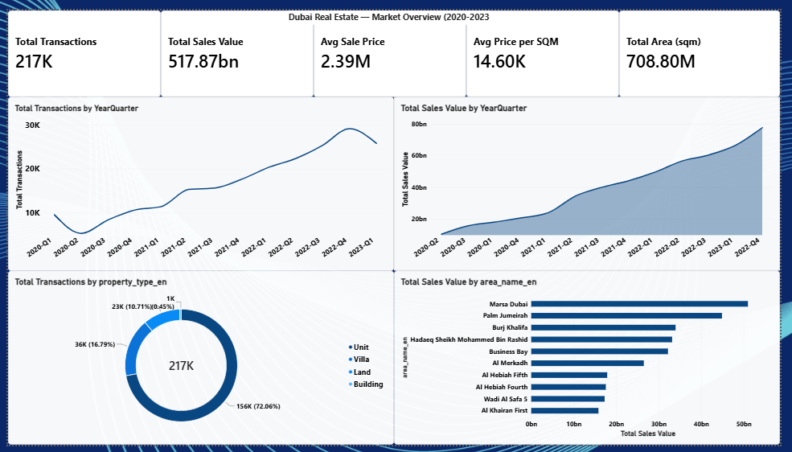

# Dubai Real Estate Analytics

End-to-end analysis of **1M+ raw Dubai Land Department transactions**, cleaned and filtered to **286K recent transactions (2020–2023)**. The project covers data profiling and cleaning in Python, 20 SQL analysis queries in MySQL, and a 4-page Power BI dashboard with recommendations.

**Headline findings:** properties with parking sell at a **52% higher price per sqm** (unadjusted), **53%** of transactions fall in the AED 500K–2M range, and **72%** of transactions are apartments.

## 📊 Power BI Dashboard



A 4-page interactive dashboard built on 286K cleaned transactions:

- **Market Overview**: KPIs, quarterly trends, property type distribution
- **Area Analysis**: treemap and top areas by price per sqm
- **Property Analysis**: type, sub-type, room distribution and parking impact
- **Executive Summary**: key findings and recommendations

📂 [View all dashboard screenshots →](PowerBI/screenshots/)

---

## 📋 Business Problem

Dubai's real estate market generates billions in transactions every year. Investors, developers and analysts need to know:

- **Where** the highest-value transactions happen
- **What** property types dominate the market
- **How** features such as parking, location and size affect price
- **When** the market peaks and slows

## 🎯 Objectives

- Clean and prepare 1M+ raw transaction records
- Analyse pricing patterns across areas, property types and time
- Build a 4-page executive dashboard with actionable insights
- Turn the findings into clear business recommendations

## 🛠️ Tools and Technologies

| Tool | Purpose |
| --- | --- |
| **Python (Pandas)** | Data profiling, cleaning, derived columns |
| **MySQL** | Data storage and 20 business analysis queries |
| **Power BI** | Interactive 4-page dashboard |
| **DAX** | Calculated measures (formatted KPIs, time intelligence) |

## 🗄️ Dataset

**Source:** Dubai Land Department transactions, via Kaggle (https://www.kaggle.com/datasets/alexefimik/dubai-real-estate-transactions-dataset)

| Metric | Value |
| --- | --- |
| Raw records | 1,047,965 |
| Raw columns | 46 |
| Cleaned records | 286,303 |
| Cleaned columns | 34 |
| Date range | 2020–2023 |

## 🧹 Data Cleaning

| Problem | What I did |
| --- | --- |
| Mixed Arabic and English duplicate columns | Dropped 12 duplicate Arabic columns |
| Near-empty columns (96%+ NULL) | Removed 2 columns |
| Dates stored as text | Converted to datetime |
| Too much old data for a recent-market analysis | Filtered to 2020–2023 (286K records kept) |
| No price per sqm or time fields | Created `year`, `month`, `quarter` and `price_per_sqm` |

Notebooks: `01_data_profiling.ipynb` and `02_data_cleaning.ipynb`

## 🔍 SQL Analysis (20 queries)

Covers market overview, area analysis, property segmentation, time trends, window functions and median calculations. See `analysis_queries.sql`.

## 🔑 Key Insights

- **AED 517.87 billion** in total sales across **217K sales transactions** (the 286K cleaned records also include other transaction types)
- **Units dominate:** 72% of transactions are apartments
- **Parking premium:** properties with parking sell at **52% higher** price per sqm (AED 16.36K vs 10.72K), before adjusting for area or size
- **Mid-tier is the largest segment:** 53% of transactions fall in AED 500K–2M
- **Premium areas lead revenue:** Marsa Dubai, Palm Jumeirah, Burj Khalifa
- **1 BHK** is the most in-demand room type

## 💡 Recommendations

1. **Target mid-tier buyers:** 53% of transactions are AED 500K–2M
2. **Highlight parking in listings:** properties with parking show a 52% premium, though this should be checked against area and size before quoting it to clients
3. **Focus on high-value areas:** Marsa Dubai and Palm Jumeirah lead revenue
4. **Prioritise apartment inventory:** apartments are 72% of transactions
5. **Build more 1 BHK supply:** it has the highest transaction volume

## ⚠️ Limitations

- Results describe recorded transactions from 2020–2023, not current prices.
- The parking premium is a direct comparison of averages. It is not adjusted for area, size or property type, so part of the gap may come from those factors.
- The data has sale prices only, so it cannot measure rental yield.

## 🔭 Next Steps

- Compare parking premiums within the same area and size band to separate the parking effect from location and size.
- Add more recent transactions to check whether the 2020–2023 patterns still hold.
- Combine with rental data to estimate yield by area.

## 🤖 AI-Assisted Workflow

I used ChatGPT and Claude to debug SQL window functions, brainstorm business implications and review DAX measures. I checked every suggestion against the data and business logic, and corrected 8+ logic errors.

## 📁 Repository Structure

```
dubai-real-estate-analytics/
├── PowerBI/
│   └── screenshots/             # Dashboard screenshots (4 pages)
├── 01_data_profiling.ipynb      # Python data profiling
├── 02_data_cleaning.ipynb       # Python data cleaning
├── analysis_queries.sql         # 20 business analysis queries
└── README.md
```

## 🚀 How to Run

1. Download the dataset from the Kaggle link above.
2. Run the two notebooks in order to profile and clean the data.
3. Load the cleaned data into MySQL.
4. Run `analysis_queries.sql`.

## 👤 Author

**Yusuf Baig**, Data Analyst | SQL · Power BI · Python | Open to roles in Dubai, UAE

- LinkedIn: [linkedin.com/in/yusuf-baig-783906210](https://www.linkedin.com/in/yusuf-baig-783906210/)
- GitHub: [@Yusufbaig2001](https://github.com/Yusufbaig2001)
- Email: yusufbaig2001@gmail.com
