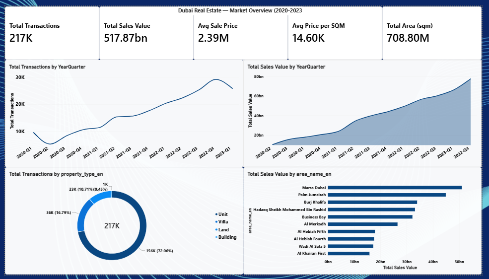
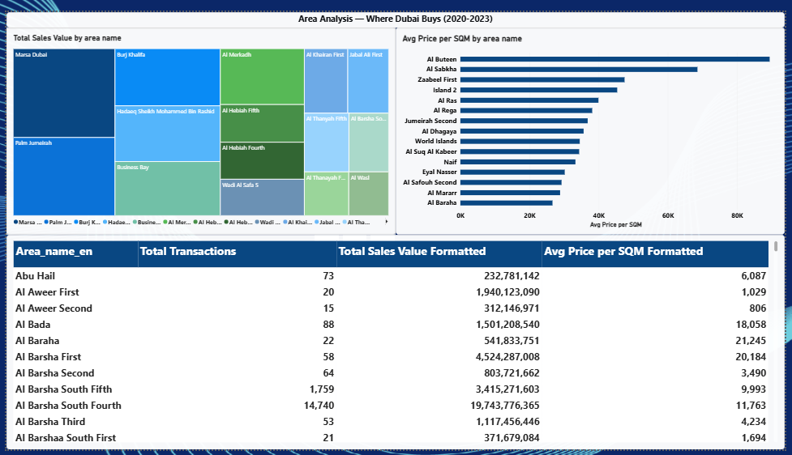
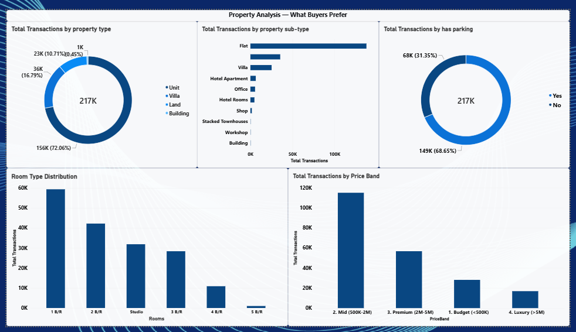
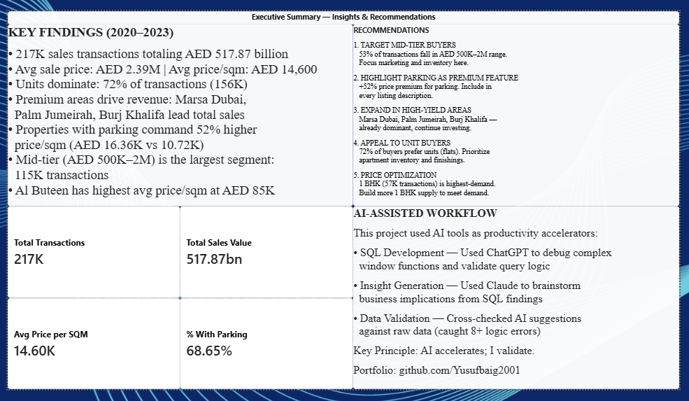

# Dubai Real Estate Analytics

End-to-end analysis of **1M+ raw Dubai Land Department transactions**, cleaned and filtered to **286K recent transactions (2020–2023)**. The project covers data profiling and cleaning in Python, 20 SQL analysis queries in MySQL, and a 4-page Power BI dashboard with recommendations.

**Headline findings:** properties with parking sell at a **52% higher price per sqm**, **53%** of transactions fall in the AED 500K–2M range, and **72%** of transactions are apartments.

## Dashboard Preview

### 1. Market Overview

### 2. Area Analysis

### 3. Property Analysis

### 4. Executive Summary

## Project Overview

**Business objective:** Understand Dubai's real estate transaction patterns and identify insights that may help investors, developers and property-market analysts.

Key business questions:

- Which areas have the highest transaction volumes and sales values?
- Which property types have higher average prices per square metre?
- How does parking availability relate to property prices?
- Which property sub-types are most frequently transacted?
- How have sales values changed over time?
- Which price bands account for the largest share of transactions?

## Dataset

**Source:** Dubai Land Department transactions dataset, available through Kaggle.

[Dataset source – Kaggle](https://www.kaggle.com/datasets/alexefimik/dubai-real-estate-transactions-dataset)

| Dataset detail | Value |
|---|---:|
| Raw records | 1,047,965 |
| Raw columns | 46 |
| Cleaned records | 286,303 |
| Cleaned columns | 34 |
| Analysis period | 2020–2024 |

## Project Workflow

### 1. Python – Data Profiling and Cleaning

Used Python and Pandas to:

- Inspect the raw dataset structure and data types.
- Analyse missing values and data quality.
- Remove duplicate Arabic-language columns.
- Remove two rental-related columns with more than 96% missing values.
- Convert transaction dates into datetime format.
- Filter records to the 2020–2024 period.
- Create year, month, quarter and price-per-square-metre fields.
- Export the cleaned dataset for MySQL analysis.

**Notebooks:**
- `01_data_profiling.ipynb`
- `02_data_cleaning.ipynb`

### 2. MySQL – Business Analysis

Prepared 20 SQL analysis queries covering:

- Data validation and duplicate checks.
- Overall market performance.
- Area and regional comparisons.
- Property type and room distribution.
- Median sale price calculations using window functions.
- Price-band segmentation using CASE.
- Project-level sales analysis.
- Monthly and quarterly trends.
- Month-over-month growth using LAG().
- Running totals using window functions.

**SQL file:** `analysis_queries.sql`

### 3. Power BI – Dashboard Development

Created a four-page Power BI dashboard:

- **Market Overview:** Overall transaction and market performance.
- **Area Analysis:** Geographical comparisons and area-level pricing.
- **Property Analysis:** Property types, sub-types, room distribution and parking.
- **Executive Summary:** Key findings and business recommendations.

## Key Analytical Areas

The project investigates:

- Transaction volume and total sales value.
- Average sale price and average price per square metre.
- Property-type performance.
- Area-level transaction patterns.
- Parking availability and price differences.
- Room-type transaction distribution.
- Monthly and quarterly sales trends.
- Sales growth and cumulative sales value.

**Important:** Numerical findings and dashboard KPIs should be reconciled with the final cleaned dataset and revised SQL outputs before being treated as final results.

## Business Recommendations

Based on the descriptive analysis, potential areas for further investigation include:

1. **Mid-market segment:** Examine the AED 500K–2M price band to understand its share of transaction activity.
2. **Property features:** Investigate the relationship between parking availability and price per square metre.
3. **Location strategy:** Compare high-volume and high-value areas separately.
4. **Property mix:** Review apartment and room-type transaction patterns.
5. **Market trends:** Monitor monthly and quarterly changes in transaction values.

## Tools and Technologies

| Technology | Purpose |
|---|---|
| Python | Data profiling and cleaning |
| Pandas | Data manipulation |
| MySQL | Data analysis and business queries |
| SQL | CTEs, JOINs, aggregations and window functions |
| Power BI | Interactive dashboard |
| DAX | Dashboard calculations and measures |
| Generative AI | Coding assistance, debugging and documentation |

## Limitations

- The analysis covers historical transactions from 2020–2024 and does not represent current property prices.
- The parking comparison is descriptive; it does not isolate the effect of parking from property size, location or type.
- Metro information availability does not establish actual distance or travel time to a metro station.
- Transaction volume is not the same as buyer demand or property inventory.
- The dataset contains sale-related and other transaction categories; sales analysis filters to `trans_group_en = 'Sales'`.
- Missing values in some property and location fields may affect individual comparisons.

## AI-Assisted Development

Generative AI tools, including ChatGPT and Claude, were used to support SQL development, Python troubleshooting, analytical explanations and project documentation.

AI-generated suggestions were reviewed and refined during the project workflow. The project is intended to demonstrate the ability to understand analytical questions, inspect data, review query logic and interpret business results—not simply generate code.

## Repository Structure

- `01_data_profiling.ipynb` – Initial dataset inspection.
- `02_data_cleaning.ipynb` – Data cleaning and preparation.
- `analysis_queries.sql` – MySQL business analysis.
- `page1_market_overview.png` – Dashboard screenshot.
- `page2_area_analysis.png` – Dashboard screenshot.
- `page3_property_analysis.png` – Dashboard screenshot.
- `page4_executive_summary.png` – Dashboard screenshot.

## Author

**Yusuf Baig**  
Data Analyst | Python | SQL | Excel | Power BI

- LinkedIn: [Yusuf Baig](https://www.linkedin.com/in/yusuf-baig-783906210/)
- GitHub: [@Yusufbaig2001](https://github.com/Yusufbaig2001)

Open to entry-level Data Analyst opportunities in Dubai, UAE.
